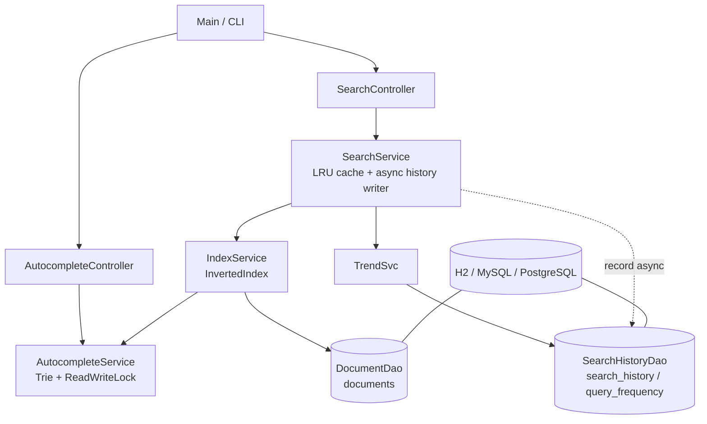

# Mini Search Engine

A small, full-stack search engine built in Java to demonstrate the data structures and
algorithms behind real search systems: a **Trie** for autocomplete, an **inverted index**
with **TF-IDF** ranking, a custom **O(1) LRU cache**, a **min-heap** top-K selector, and a
**JDBC + SQL** layer for trending analytics. Includes thread-safety (read-write locks,
`ConcurrentHashMap`, atomic counters, async history writes) and a benchmark.

---

## Features

- **Autocomplete** — prefix → top-K suggestions, ordered by frequency (Trie + min-heap).
  Optional per-node top-K cache makes lookups **O(L)**.
- **Search** — multi-keyword queries over an inverted index with **AND / OR** semantics
  (two-pointer intersection / union) and **TF-IDF** ranking.
- **Top-K ranking** — size-K **min-heap** selects the best results in **O(n log K)**
  instead of a full sort.
- **LRU cache** — custom `HashMap` + doubly linked list giving **O(1)** `get`/`put`,
  cutting repeated-query latency.
- **Trending** — `GROUP BY`, time-windowed, and zero-result analytics from SQL.
- **Concurrency** — fixed thread pool for concurrent searches; `ReentrantReadWriteLock`
  around the Trie/index; `LongAdder`/`AtomicInteger` counters; search history written
  **asynchronously** by a background worker so the search path stays fast.

---

## Architecture



### Layered architecture

```
controller/   SearchController, AutocompleteController     <- request entry
service/      SearchService, AutocompleteService,         <- orchestration + cache
              IndexService, TrendingService
dao/          DocumentDao, SearchHistoryDao,              <- JDBC / SQL
              SchemaInitializer
index/        InvertedIndex, Trie, TrieNode, TopKSelector  <- core DSA
cache/        LRUCache                                       <- custom O(1) LRU
model/        Document, SearchResult, SearchHistory,
              Suggestion, QueryStats
util/         Tokenizer, TextUtils, DbConnection
seed/         SampleData
Main.java                                                    <- interactive CLI
```

Rule: **controller → service → dao/index**. A controller never touches a DAO or a data
structure directly.

---

## Data structures & complexity

| Component | Structure | Key operation | Complexity |
|-----------|-----------|---------------|------------|
| Autocomplete | Trie | `insert` / `searchPrefix` | O(L) |
| Autocomplete | Trie + DFS + min-heap | top-K suggestions | O(L + N log K) |
| Autocomplete | Trie + per-node cache | top-K (cached) | O(L) |
| Search | Inverted index (`Map<word, Map<docId, tf>>`) | lookup | O(sum of posting lengths) |
| Search | AND = two-pointer intersect, OR = union | combine lists | O(m + n) |
| Ranking | TF-IDF `tf * log(N / (1 + df))` | score a doc | O(query terms) |
| Top-K | size-K min-heap (`PriorityQueue`) | select top-K | O(n log K) |
| Cache | HashMap + doubly linked list | `get` / `put` | O(1) |
| Trending | SQL `GROUP BY` + indexes | aggregate | back by `idx_query`, `idx_time` |

---

## Setup & run

Requirements: **JDK 17+** and **Maven**. The database is H2 (in-memory), so no external
server is needed — swap the JDBC URL in `util/DbConnection` for MySQL/PostgreSQL to run
against a real database (the DAOs use plain JDBC, so nothing else changes).

```bash
# build + run tests
mvn clean test

# start the interactive CLI
mvn exec:java
```

### CLI menu

```
1.  Search (AND, all terms)
2.  Search (OR, any term)
3.  Autocomplete suggestions
4.  Trending (all time)
5.  Trending (last 24h)
6.  Zero-result queries
7.  Documents by category
8.  Reindex from DB
9.  Benchmark (cache vs no-cache)
10. Concurrent search demo
11. Stats
0.  Exit
```

On first run the DB is seeded with a built-in corpus (33 documents across 6 categories).
The benchmark can additionally generate synthetic documents (e.g. 2000–100000) to
measure latency at scale.

---

## Sample output

Search (`AND`, `java streams`):
```
2 result(s):
   1. [11.4141] Java Streams Tutorial
   2. [8.7285] Introduction to Java
```

Autocomplete (`jav`):
```
Suggestions:
  java (7)
  javascript (3)
  java streams (1)
```

Documents by category:
```
1. programming -> 8 searches
2. cooking -> 5 searches
3. finance -> 5 searches
4. health -> 5 searches
5. sports -> 5 searches
6. travel -> 5 searches
```

---

## Benchmark

Measured on this machine (2000 generated documents, 100 queries per scenario). Run the
benchmark (`menu → 9`) on your own machine and fill in your own numbers — don't copy these.

| Scenario | Latency |
|----------|---------|
| With cache (warm) | ~15 µs/query |
| Without cache (cold) | ~207 µs/query |
| **Speedup** | **~13.6x** |

Concurrent demo (100 searches, 8 threads): ~25,000 searches/sec.

The cold path is slower because every query tokenizes, intersects posting lists, and runs
TF-IDF over all matching documents; the warm path returns a cached list and slices it.
Cache hit/miss and history-queue depth are surfaced in `Stats` (menu → 11).

---

## Concurrency notes

- `InvertedIndex` is backed by `ConcurrentHashMap` so concurrent reads and writes are safe
  without an external lock for the common case.
- `AutocompleteService` guards the Trie with a `ReentrantReadWriteLock` — reads (suggestions)
  are far more frequent than writes (new terms/queries), so this lets concurrent readers
  proceed while a write takes the exclusive lock.
- `LRUCache` uses a single `ReentrantLock` held only for the brief O(1) operations.
- Search history is written by a single background worker fed by a bounded queue
  (`offer` → drop + count on backpressure), so the search response never blocks on DB I/O.
- Stats counters use `LongAdder` / `AtomicInteger` to avoid contention.

---

## Testing

33 JUnit 5 tests covering: Trie prefix ordering / empty query / frequency accumulation /
cached vs DFS parity / clear, inverted-index posting lists / AND/OR intersection /
TF-IDF ranking, LRU eviction order / update-and-move / concurrent access, tokenizer
stopword/punctuation handling, and an end-to-end `SearchService` test against H2
(cache hit/miss, AND/OR, reindex invalidation, autocomplete by frequency).

```bash
mvn test
```

---

## Resume bullet points (examples — replace X with your measured numbers)

- Built a Java search engine with an inverted index and TF-IDF ranking, serving
  multi-keyword (AND/OR) queries over a 2K-document corpus.
- Implemented Trie-based autocomplete with top-K suggestions via a min-heap, achieving
  O(L) prefix lookup with a per-node suggestion cache.
- Designed a custom O(1) LRU cache (HashMap + doubly linked list) that cut repeated-query
  latency by ~13x.
- Used SQL (`GROUP BY`, time-window filters, indexing) to compute trending and zero-result
  searches, with concurrent request handling via a thread pool, read-write locks, and async
  history writes.

---

## Possible extensions

- Typo tolerance (Levenshtein distance / "did you mean?")
- Phrase search ("exact phrase")
- Stemming (running → run) and pagination
- REST API + small HTML frontend (Spring Boot or `com.sun.net.httpserver`)
- Persist the index to disk
- Dockerize
